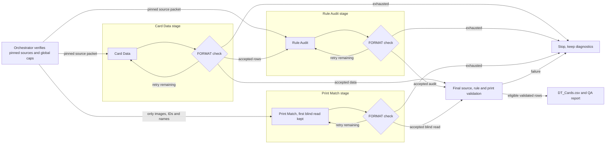

# F.A.M-E.D. card crew (Assignment 3)

This repository holds the agent crew for **F.A.M-E.D.**, my co-op deck-building dungeon crawler. Game page: https://pierofolly.crafts.games/f-a-m-e-d/

Report (PDF): [FAMED_Assignment3_Agent_Crew_Report.pdf](FAMED_Assignment3_Agent_Crew_Report.pdf)

## What the crew produces

The crew turns six printed skill cards (SK1_01, SK1_02, SK1_03, SK1_04, SK3_01, SK4_01) into game-ready card data. The planned output is `DT_Cards.csv`, one row per card. The F.A.M-E.D. Unreal Engine data table `DT_Cards` will read the file. A `qa-report.md` comes with it.

## The crew

| Agent | Job | If removed |
|---|---|---|
| Card Data (`agents/card-data.md`) | Extracts the exact card fields from the pinned sources | No rows, the pack is refused |
| Rule Audit (`agents/rule-audit.md`) | Checks the rows against the game rules on its own | No rule result, the pack is refused |
| Print Match (`agents/print-match.md`) | Reads the printed card images blind, then compares | No blind read, the pack is refused |
| Orchestrator (`run_crew.py`) | Only writer of files. Builds each agent's packet and enforces call and token caps. This copy has no live model connection | No run |
| Validator (`validate.py`) | Checks sources, schema and the blind read before any CSV is released | No CSV release |

## Diagram

The full diagram, with the QA-only branch and my three review gates, is in `crew-diagram.mmd`.

## How it works

- By design, each agent sees only the packet the orchestrator builds, and Print Match never sees the other agents' output. In my fresh run, the workers were told to read only their packet or images. That was an instruction, not a locked sandbox.
- A stage that fails its format check retries up to 3 times. Global caps: 10 calls, 400,000 tokens.
- Source or rule failures stop the run for review. They never retry.
- Files: `agents/` (agent instructions), `schema/` (row contract and the three stage schemas), `run_crew.py`, `validate.py`, `packet_support.py`, `source_policy.py`.

## Evidence in this repository

`sample-run/` holds the log and QA report of one offline replay from 28 October 2026. It used made-up test answers and made 0 model calls. It is an old record of the pipeline, not a test of the current code. I reworded the QA report text for this copy. I approved no release.

## What is not here

The pinned source texts (game rules, design document, card sheets and card images) are withheld. They are my unpublished design work. In this copy every mode of `run_crew.py` stops before any agent step. Replay stops at a missing fixture file. Dry run, canary and stop demo stop on a local error. The skip demo stops on its skipped stage. Live mode has no model connection by design. I tested all six modes. Ask me for a walkthrough or a screen share of a full run.
